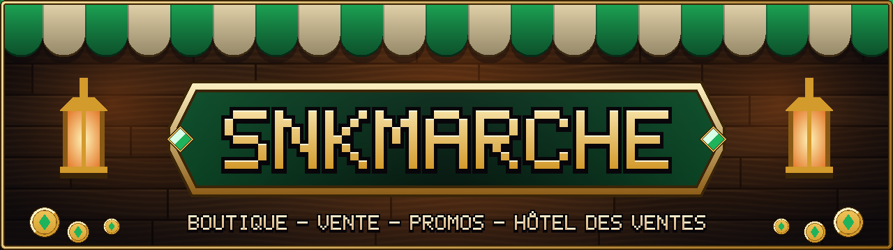
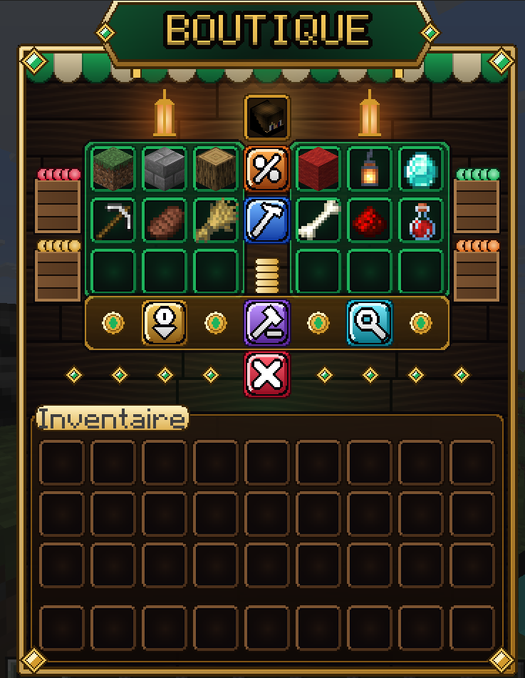
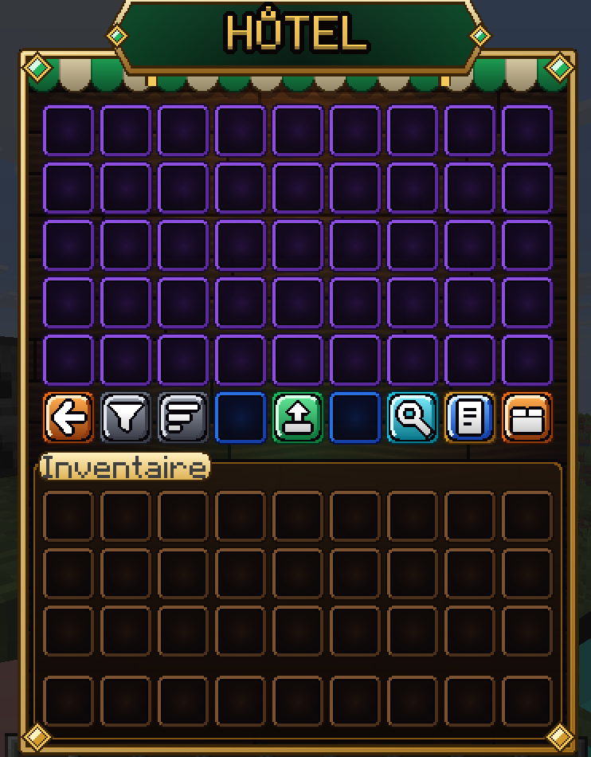

<b>Une boutique complète, la vente d'objets, des promos chaque jour et un hôtel des ventes entre joueurs.</b> 
Plugin Minecraft pour serveurs <b>Paper 1.21.4 à 26.3</b>, par <b>SnkAlex</b>.

<a href="#-fonctions">Fonctions</a> •
<a href="#-captures">Captures</a> •
<a href="#-commandes">Commandes</a> •
<a href="#-compatibilité">Compatibilité</a> •
<a href="#-lobtenir">L'obtenir</a>

---

## ✨ Fonctions

### 🛒 La boutique `/shop`
- **1 300 objets** et 31 potions, rangés en **12 rayons**
- Achat par petites ou grandes quantités, ou pour remplir tout l'inventaire
- **Recherche** par nom, en français ou en anglais
- Tous les prix se changent dans un seul fichier

### 💰 La vente `/sell`
- La boutique rachète les objets neufs, à petit prix (20 % par défaut)
- `/sell main`, `/sell tout`, ou un menu qui montre ce que chaque objet rapporte
- **Plafond par jour et par produit**, contre les fermes automatiques

### 🔥 Les promos
- **5 produits moins chers chaque jour** (−20 à −50 %), surtout des minerais
- Elles changent à minuit, avec compte à rebours et annonce dans le chat

### 🔨 L'hôtel des ventes `/ah`
- Les joueurs vendent entre eux au prix qu'ils veulent
- Filtre par rayon, tri, recherche par objet ou par vendeur
- Le vendeur est **payé même déconnecté**
- Les invendus attendent dans une **boîte de retour**
- On peut **regarder dans une shulker** avant de l'acheter
- Taxe, durée et nombre d'annonces réglables, historique des achats et des ventes

### 🛡️ Pas d'argent infini
Au démarrage, le plugin relit **toutes les recettes du serveur**. Si un prix permet de gagner de l'argent en achetant, en fabriquant puis en revendant (même en promo), il est baissé tout seul.

### 🎨 Des menus dessinés
Les menus ont leur propre interface grâce à un pack de ressources fourni. Les joueurs qui n'ont pas le pack voient des menus classiques.

---

## 📸 Captures

| La boutique | L'hôtel des ventes |
|:---:|:---:|
|  |  |

---

## ⌨️ Commandes

| Commande | Effet |
|---|---|
| `/shop` (ou `/boutique`) | Ouvre la boutique |
| `/shop <mot>` | Cherche un produit |
| `/shop promos` | Les promos du jour |
| `/sell` (ou `/vendre`) | Menu de vente |
| `/sell main` · `/sell tout` | Vend la pile en main · tout l'inventaire |
| `/ah` (ou `/hdv`) | Hôtel des ventes |
| `/ah vendre [prix] [quantité]` | Met en vente l'objet en main |
| `/ah chercher <mot>` | Cherche un objet ou un vendeur |
| `/ah mes` · `/ah retours` · `/ah historique` | Ses annonces, ses objets à reprendre, son historique |
| `/marche reload` | Recharge les réglages (admin) |
| `/marche promos` | Tire de nouvelles promos (admin) |
| `/marche vider <joueur>` | Remet son plafond de vente à zéro (admin) |

**Permissions :** `snkmarche.admin` (admin), `snkmarche.sansplafond` (pas de plafond de vente).

---

## 🧩 Compatibilité

| | |
|---|---|
| **Versions** | 1.21.4 à 26.3, un seul fichier pour toutes |
| **Testé sur** | Paper 1.21.4, 1.21.11, 26.2 et 26.3 |
| **Serveur** | Paper |
| **Java** | 21 ou plus (celui de ta version de Paper) |
| **Obligatoire** | Vault et une économie (EssentialsX, SnkMetiers...) |

Les objets qui n'existent pas dans ta version sont retirés de la boutique automatiquement.

**Va plus loin avec les autres plugins Snk** (facultatifs) :
- **[SnkPNJ](https://github.com/SnkStudio/SnkPNJ)** : un marchand qui ouvre la boutique
- **[SnkInterface](https://github.com/SnkStudio/SnkInterface)** : la boutique et l'hôtel des ventes dans un menu principal
- **[SnkCosmetiques](https://github.com/SnkStudio/SnkCosmetiques)** : des cosmétiques 3D à acheter avec l'argent gagné au marché
- **[SnkPass](https://github.com/SnkStudio/SnkPass)** : un pass de saison avec des bons de réduction pour la boutique
- **[SnkBoutiques](https://github.com/SnkStudio/SnkBoutiques)** : les joueurs ouvrent leurs propres boutiques avec des coffres
- **[SnkClans](https://github.com/SnkStudio/SnkClans)** : réduction de clan à la boutique, et une part de la taxe va à la banque du clan
- **[SnkMetiers](https://github.com/SnkStudio/SnkMetiers)** : plus d'annonces à l'hôtel des ventes selon le niveau
- **[SnkGemmes](https://github.com/SnkStudio/SnkGemmes)** : la houe en saphir vend les récoltes toute seule, au prix de la boutique

---

## 📦 Ce que tu reçois
- Le plugin (`.jar`)
- Le pack de ressources des menus
- Le guide d'installation et le guide complet, en français

Aucune connaissance en code n'est nécessaire : tout se règle dans deux fichiers.

---

## 📩 L'obtenir

Le plugin n'est pas en téléchargement libre. Pour le prix, une question ou une démonstration :

➡️ **[Écris-moi ici](../../issues/new/choose)** (il faut un compte GitHub, c'est gratuit)

> Les messages sont **publics** : n'écris ni adresse e-mail, ni mot de passe, ni information de paiement. On passe ensuite en privé.

---

© SnkAlex. Tous droits réservés. Voir <a href="LICENSE.md">la licence</a>. 
Ce plugin n'est pas un produit officiel Minecraft. Il n'est ni approuvé par Mojang ou Microsoft, ni associé à eux.

